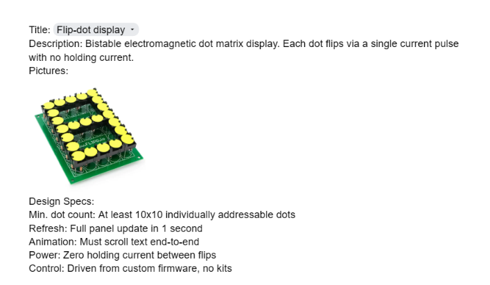
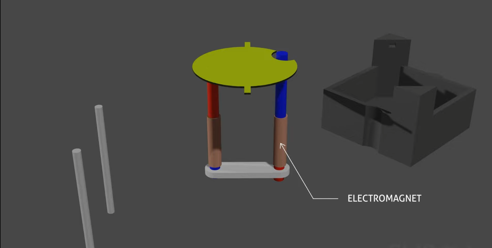
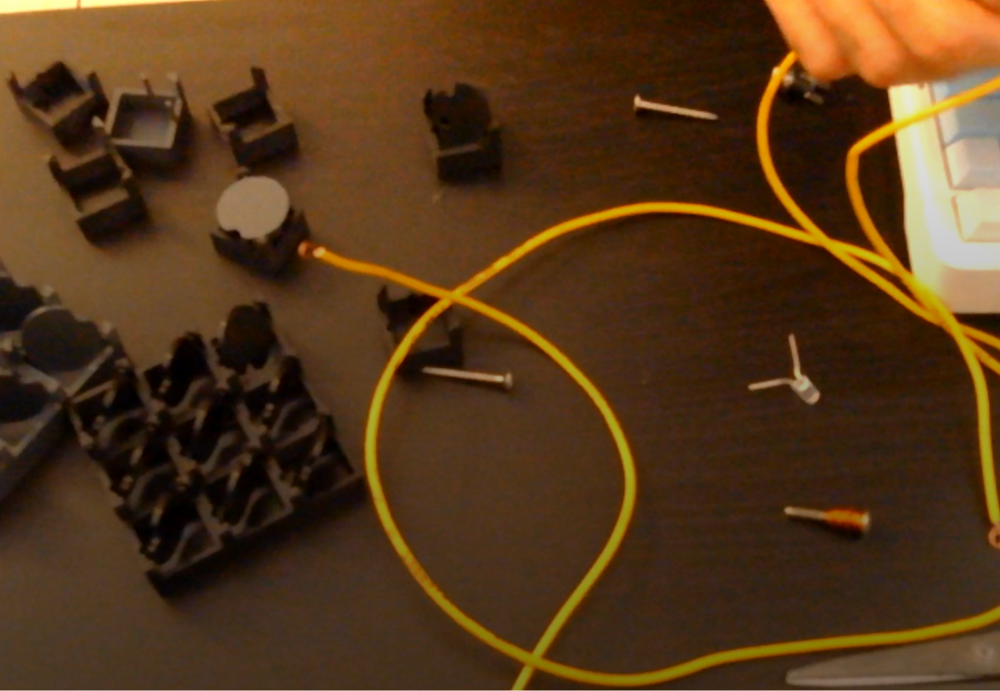
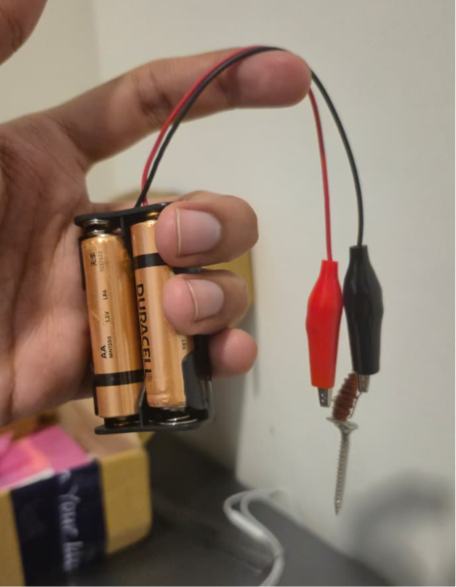
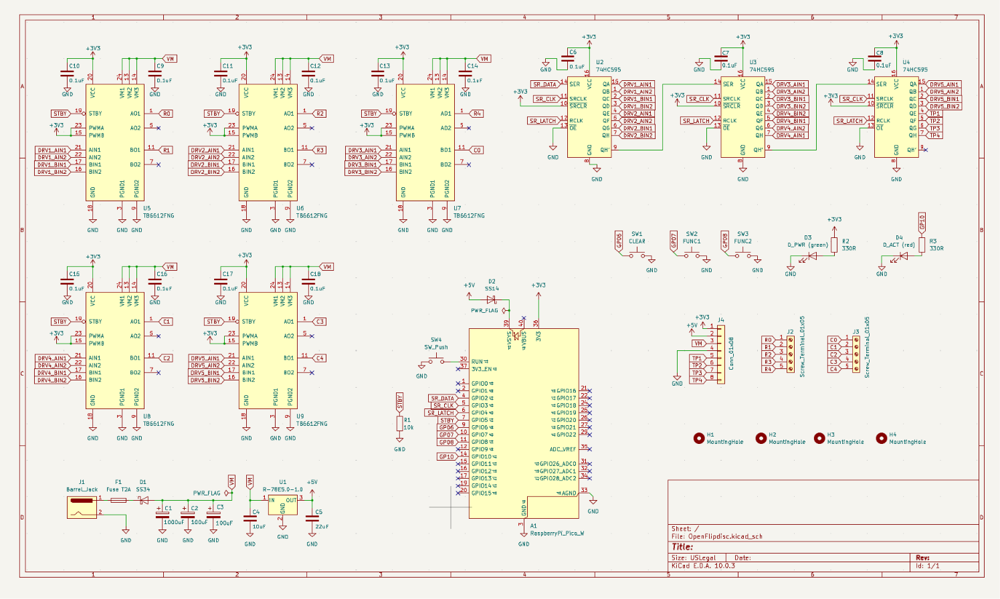
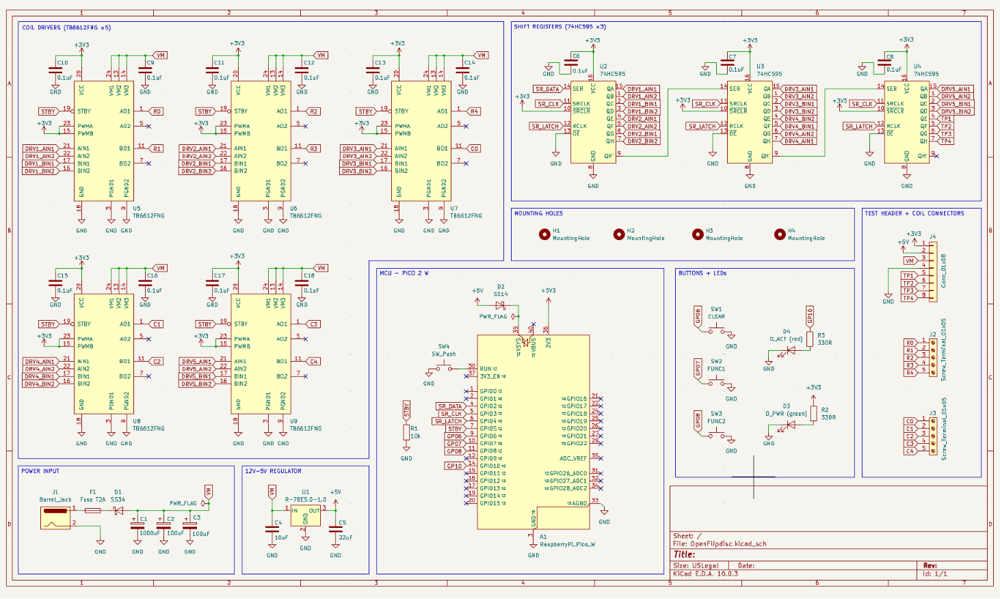
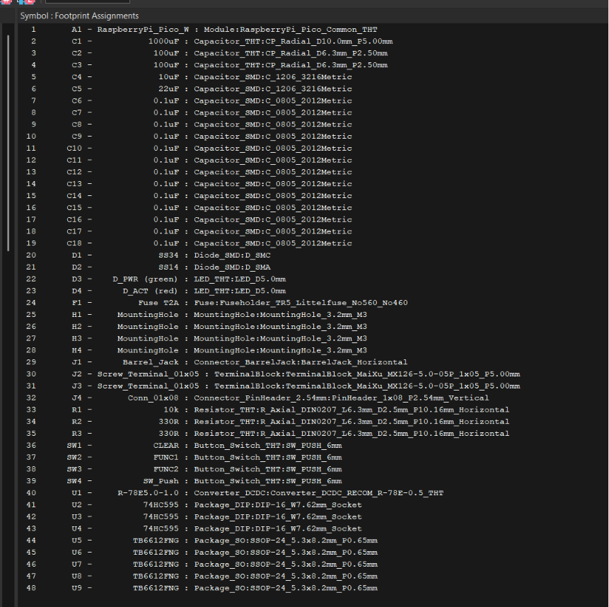
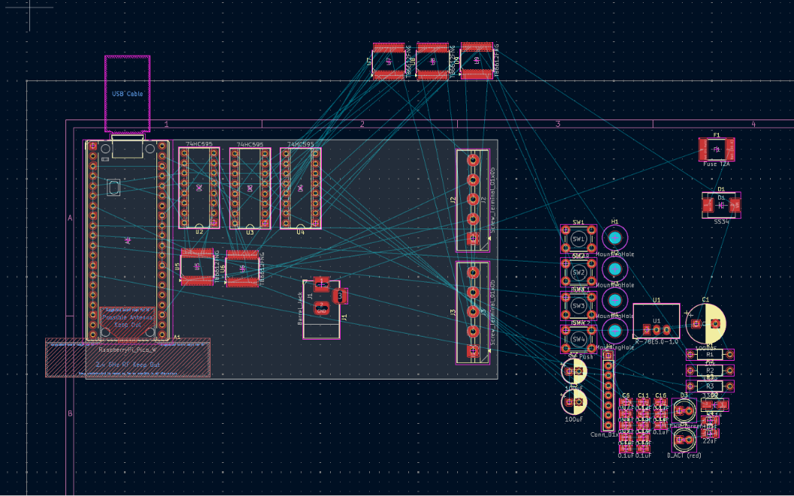
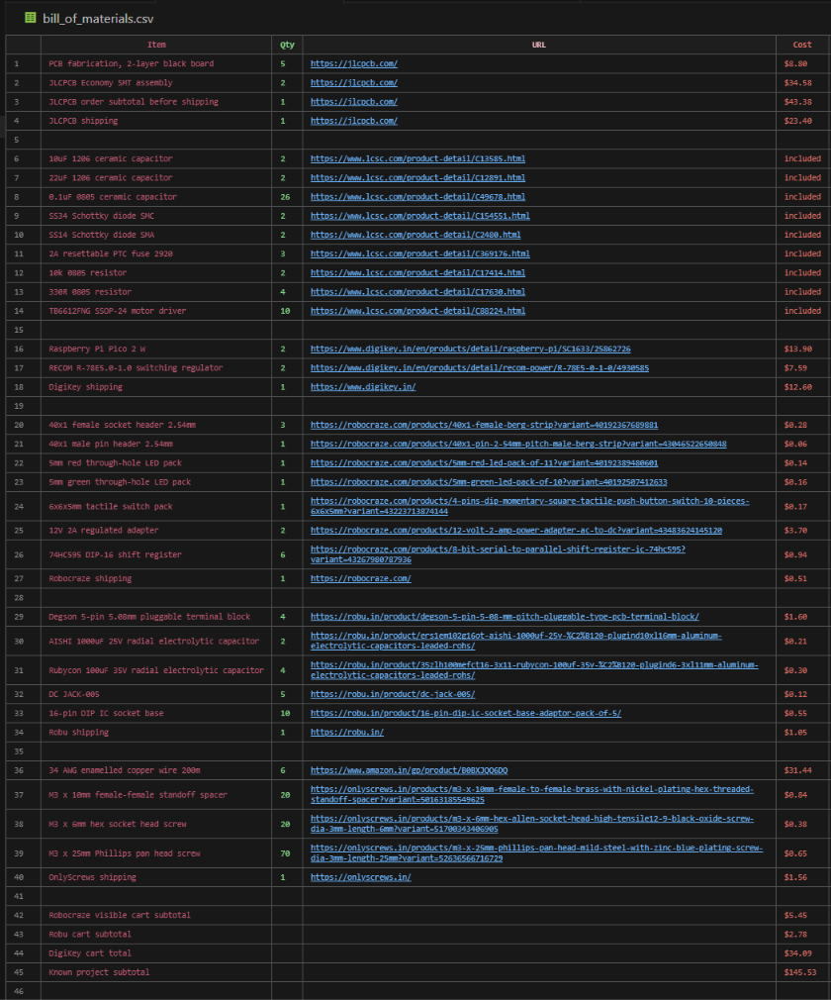

## 12th June, 2026: The idea was born!

**08:32 PM:**
So, before I begin, let me say that I've always been very fond of mechanical displays... the way they work, operate, and make sounds is super cool to me. I saw "Flip Dot Display" mentioned on the hardware, I was amazed and pretty much decided that THIS right here is what im gonna build for open sauce.

I was thinking maybe I could make a gameboy type controller but render everything on the big flip disc display? we can have games like: snake, tetris, connect4 etc..

I also some some cool switches on robu (easily accessible online hardware store) few days ago so maybe i can use that for a joystick???

**9:58 PM:**
Okay, before i start, i decided maybe i should look for the parts i wanna use and the key part was the flip dot display itself, I looked it up, but couldn't find it anyhwere. i saw lots of videos and stuff but the purchase part was tricky.

apaprently, they were used in buses because the LEDs were not bright enough and they were pretty loud if on large scale. there was this company which sells them but ONLY if you have a valid transportation license or own multiple buses, which I clearly don't....

I looked up flipo.io (the one site mentioned in the flipdot reference image) but apparently they only have a croudfunding link and no further details

there's another site which is flipdots.com but their flip dots are kinda expensive. im not sure if the project budget allows me to get that...

> **total time spent: 3.5hrs**

---
## 13th June, 2026: I figured out I can build my own!!

**06:32 AM:**
I pretty much stayed up all night today trying to figure out my situation. I tried to find places where i can purchase, even looked up ebay but had no luck.

Big chunk of my time was spent in trying to understand how these things work, how they come together and understanding the mechanics... I saw a couple of videos where people build stuff with these flip dot displays but eventually everyhting would lead me to this one answer about where did they get it from: 1) bought from flipdots.com, or 2) found on sale on ebay.. neither of the things worked for me however I realised it's kind of not that difficult to build one on your own.. 

I tried to collect and review every single resource I could find that could be helpful to my case.. 

[https://flipdots.cargo.site](https://flipdots.cargo.site)
[https://flipdisc.io](https://flipdisc.io)
[https://github.com/chrishemmings/flipPyDot](https://github.com/chrishemmings/flipPyDot)
[https://flipdots.com/en/home/](https://flipdots.com/en/home/)
[https://github.com/CarlRaymond/AnnaxFlipdotDriver/](https://github.com/CarlRaymond/AnnaxFlipdotDriver/)
[https://hackaday.io/project/202125-fliphex-3d-printed-flip-dots/log/237704-project-log-0-preface-and-previous-experiments](https://hackaday.io/project/202125-fliphex-3d-printed-flip-dots/log/237704-project-log-0-preface-and-previous-experiments) 
[https://hackaday.io/project/189878-flip-disc-display-how-it-works-how-it-is-built](https://hackaday.io/project/189878-flip-disc-display-how-it-works-how-it-is-built)
[https://pierremuth.wordpress.com/2021/02/17/flipping-dots-fast/](https://pierremuth.wordpress.com/2021/02/17/flipping-dots-fast/)

a demonstration image which helped me understand the module better

by this time, i had a good understanding of what to do and realised i can actually do this. 

**08:24 AM**
I found a reference single flip disc module case online, made a 3x3 verison of it and sent it for printing... this seemed to had some issues but im fine with it.. i just wanna get my hands on something that works ASAP!!

> **total time spent: 8.5hrs**

---
### 14th June, 2026: first variation of the case..

**10:30 AM:**
I wasn't able to get my prints last night, but they just arrived and here's how it looks: 

this was a simple print, but it has some flaws...

- the discs collide with each other in some scenarios
- the holes are not big enough to install a good EM base
- the friction was bad when the disc was supposed to spin
- discs would fall and slip out easily
- there was no magnet mount on the disc
- the weight distribution was imperfect

I played around with it for quite a bit.. i tried to find nails that could possibly fit in there so i could test.. there was also no place to mount the magnets and there was nothing i could have done except flip around and get an idea of how this thing works. but this has been very helpful so far

> **total time spent: 9.5 hrs**

---
### 17th june, 2026: making MY OWN design for the module

**12:20 PM:**
I did some work on CAD, and made this one singular module for the flipdisc. this is a perfected design that im totally satisfied with... here's an attached image:

I decided to go with this cuz it has the following features:

- the electromagnet base holes are designed for M3 screws, the kind which is very available in the market + perfect for something like this
- the disc has a cutout designed for easy flipping, its enclosed on the other side to limit movement to only 180degrees at maximum
- the edges are polished where needed
- the screw hole has a base on the side where we can superglue it maybe? for better hold

Once this singular module was done, I decided to make a 3x3 version alongside this

> **total time spent: 14 hrs**

---
### 18th June, 2026: making an electromagnet..

**10:00 PM:**
today, I spent some of my time trying to make the electromagnet work. I've never really made an electromagnet but know how one works or atleast have some basic idea... i went shopping yesterday for some hardware components, there's a big market here in bangalore with a lot of items... I went there and got some electromagnets, some nails, a dc adapter, a dc female jack.. while i was there, i also bought some copper wire for this project

I felt like i had the basic components to test how an electromagnet would work and immediately got to work.. there was something wrong and I realised very late that instead of enamelled copper wire i accidentally got bare copper wire which would make the circuit short and nothing would work except the nail getting heated..

> **total time spent: 15 hrs**

---
### 20th Jun, 2026: the electromagnet works, but...

i ordered the right parts for my electromagnet, the correct M3 nails, proper enameled copper wire... i was lucky enough to get the items delivered by evening same day. spent time trying to see how the electromagnet works and if it was responsive enough.. it was!!! 
i was able to get it to attract items and repel the magnets but there were still a few problems i was facing:

- the magnetic effect was not as strong at the tip of the nail, that means push force wasn't enough and the disc could potentially not flip
- I also realised that the nail is not exactly soft iron (best base material for strong magnets), it was an alloy. works for testing, but not the perfect thing..
- the biggest problem, i tried to create them as two individual magnets instead of one magnet with both the rods being opposite poles.. this would allow for a stronger magnetic force and more reliable flip disc

but i think these are the biggest blockers, everything else should work properly after this (theoretically).. 

the one problem i still face is:

- how do i find a soft iron nail core
- how do i find a bearing or something of the same material that connects them

ideally i want something U shaped, or i could connect parts to make it as such and wrap the coil around it.. the biggest issue is still where to source these parts.

> **total time spent: 17 hrs**

*(hey, i fell sick for a few days & got involved in other things so couldn't get to it, i feel really bad)*

---

### 29th June, 2026: starting from where i left off..

**08:32 PM:**
didn't to much today, was playing around with electromagnets HOWEVER.... i realised there is one BIG problem with the type of screw and parts I use.. first of all it should be a U shaped electromagnetic structure to get the best out of it.. second this is.. we need to use soft iron for the nail/electromagnet base.. i was using carbon steel, which is better than stainless steel and will work better when acting as an electromagnet however it has remanance properties.. basically even if we cut off the current it will hold on to some magnetic effect and that can be VERY problematic for this project. i will need to make sure the hardware parts I get are right and well done.. any mistake could be insanely problematic

I also spent some time testing through everything once again on the mechanical side... after reviewing everything carefully I decided to move on to building the PCB since it will take time to arrive and I dont have a lot of days before the event starts. thats #1 priority rn.. I can always come back to mechanical stuff and fix it, but I wont have time to get a new PCB.. 

> **total time spent: 18hrs**

---

### 30th June, 2026: gathering the PCB parts

**11:05 PM:**
I started the work on schematics just now, this is the list of components that i will have in my pcb:
(writing here too as i move on)

- [Raspberry Pi Pico 2 W](https://www.raspberrypi.com/documentation/microcontrollers/pico-series.html#pico2) (it has wireless comms, powerful enough, good for this project)
- [TB6612FNG](https://cdn.sparkfun.com/datasheets/Robotics/TB6612FNG.pdf) (dual H-bridge, allows reversing the polarity to flip electromagnet poles)
- [74HC595](https://www.ti.com/lit/ds/symlink/sn74hc595.pdf) (8-bit serial-in, parallel-out shift register IC. It acts as a digital pin expander)
- [SS34 Schottky](https://www.vishay.com/docs/88751/ss32.pdf) (reverse-polarity protection, series on +12V)
- [Recom R-78E5.0](https://recom-power.com/pdf/Innoline/R-78E-1.0.pdf) (12→5V switching reg, drop-in, 1A, no heatsink)
- [SS14 Schottky](https://www.vishay.com/docs/88746/ss12.pdf) (prevents backfeeding, makes the pcb usb safe even when power plugged in)

these things above are the key components the schematic is gonna have. i plan to have a 12V 5A dc adapter to power this thing. some other basic components that will be present in the PCB are:

- buttons (to control the flipdot display, maybe some presets, one to clear up the screen)
- a RGB led (usually stays green, goes red when the flipdots are transitioning, good feedback)
- lots of capacitors and resistors (duh)
- screw terminal (easily removable, easy to connect things)
- a fuse (i dont want to blow up the pcb if something goes wrong)

> **total time spent: 20.5hrs**

---

### July 1st, 2026: 

**11:30 AM:**
good morning, woke up pretty late, but I do somewhat have a plan to work on now. need to get started on the PCB asap. the plan is to wrap up the schematics within 2 days.. it should be done and ready. we spend another 1 day on routing and pcb work and ship it ASAP!!

**02:24 PM:**
schematics update!!!

i started out with making the power & extension system work and this is what i've done so far..

> **total time spent: 23hrs**

---

### July 2nd, 2026: 

**02:34 AM:**

added 5 of _TB6612FNG_ to use as a dual H bridge. we can use this to swap the polarity of the current for the flip discs (it's a very important component)

with these 5 chips, and 2 outputs each, we have 10 matrix lines roughly that can be used to work with a 5x5 grid of individual flip dot modules... Its built-in flyback diodes absorb the coil's kickback, so no external diodes needed. (yay)

i think I'll go to bed after this, pretty tired now..

**1:50 PM:**
i woke up pretty late, but decided to lock back in.. one of the main problems i had is i did not have enough space on my sheet so i would probably need to reorganize a lot of things to make sure i can fit everything in just one sheet. i dont want to make it too complicated with multiple schematic sheets tbh...

i decided to organize all the stuff thereafter and this is what we have now:

this looks pretty clean.. but I still need to add a lot more things and need to do some wiring on the schematic side before we move to assigning the footprints and moving forward with pcb design

**3:13 PM:**
okay, everything on the schematic is done now.. i added some things extra, increased the page size and had to do some reorganizing again before i move on cuz there was not enough space left to make it all work together... this is how the scehmatic turned out to be...

im gonna take just a lil more time to organize before i move on (i like those blue lines & labels)

**3:32 PM:**
decided to take some time to categorize things, and place them in text boxes
the schematic sheet is looking clean now (wohooo)

**04:16 PM:**
footprints are now assigned. kicad recently made some updates to the footprint library so i had some trouble finding the exact footprint i needed on J2 & J3 but after some research, looking around, I decided on another footprint which is pretty much the same thing from the new lib 
next step is the PCB design......

**06:28 PM:**
currently doing the PCB placement

**09:32 PM:** 
didn't do much after last journal, now back to working on the PCB~!!!!

**11:06 PM:**
done with the part placement, everything looks and feels right.. the resistors and some capacitors actually had wayy bigger footprints for no apparent reason so I had to go back, review them, find a size that works and had to update them again.. same issue for fuse. we had a fuse case instead of the SMD fuses.. switching to this saved so much space and makes the board look wayy cleaner + its not as hassle bcs we dont need to replace it if something goes wrong, it can fix on its own

(pcb view ^^^)

> **total time spent: 30.5 hours**

---

### July 3rd, 2026: I finished my PCB this day!!

**01:05 AM:**
routing is completed now.. im now facing issues with DRC and thats pretty much it. other than that all is done and the wires are laid out

**02:09 AM:**
done with the PCB finally.. all the drc errors have been resolved 

> **total time spent: 32.5 hrs**

---
### July 4th, 2026: wrapping things up

**03:07 AM:**
couldn't do much work during the day. i was pretty occupied in other activities.. but I figured since im journaling i might as well go more in depth about things and how is this PCB supposed to work.. whats the purpose and everything..

this is a PCB, it's not the main thing in this project. the main thing is the flip dot display. but to control it properly, give it the right amount of current for a short instant, in a VERY controlled manner, we will need more than just basic electronic wiring. i would need microcontrollers and proper tools, everything well done custom designed for the flip dot module.. this board right here is meant for a 5x5 flip dot display.. here's how it works:

- a 10 wire terminal port, which gets plugged into a grid of wires interconnecting every single module in the 5x5 display.. ie- 5 rows + 5 columns. we can power one selected row, ground one selected column, and leave every other row/column floating. that way only the coil at that one crossing gets a complete current path basically allowing us to trigger a specific module
-  basically an H-bridge driver. it lets me push current through a coil in either direction.. this is important to make sure the flipping works. the disc flips in one direction in a certain polarity, and moves back with the opposite polarity...
- we're using 12V power for this board.. we also pass this through a resettable fuse so if something shorts or pulls too much current, the board has some protection instead of instantly messing up things... the 12V power is what handles the flip discs themselves however we use a step down to bring the power down to 5V and 3V so we can power the pi pico board
- we use a raspberry pi pico 2 wireless. it gives me enough processing power to use the firmware for handing all these flip discs. i could also potentially make it work wirelessly using bluetooth or wifi and control the flip dot board from my phone by making an app for same
- we have 2 LEDs, one tells you when the board is active, the other turns red for a very small second when the flip dots are actually flipping in the moment

**04:27 AM:**
finally done with everything on the PCB end.. there were some placement misalignment issues as well that i fixed, nothing problematic but helps with my OCD, anyways.. I also did some silkscreen work on the PCB.. i realised im not the best person at drawing things so I decided to make something which resonates with the project. the silkscreen you see is a flip dot display grid with a smiley face on it.. its made using small discs, some filled some empty.. signifying a flip dot display
here's how the final PCB looks:

here's how the 3D render looks for the same thing:

**5:56 PM:**
i just finished with everything. turns out finding the parts was really expensive and I had to source everything from multiple vendors to make it all work. the PCB is coming from jlcpcb, some simple parts are coming from robu & robocraze, pi pico 2 w was cheaper on digikey and RECOM could only be found on digikey so those things are coming from there.. the enameled copper wire is coming from amazon.. and finally I have some screws (used for flip dot module to act as the solenoid base + pcb mounting) coming in from onlyscrews

> **total time spent: 37 hrs**

---

