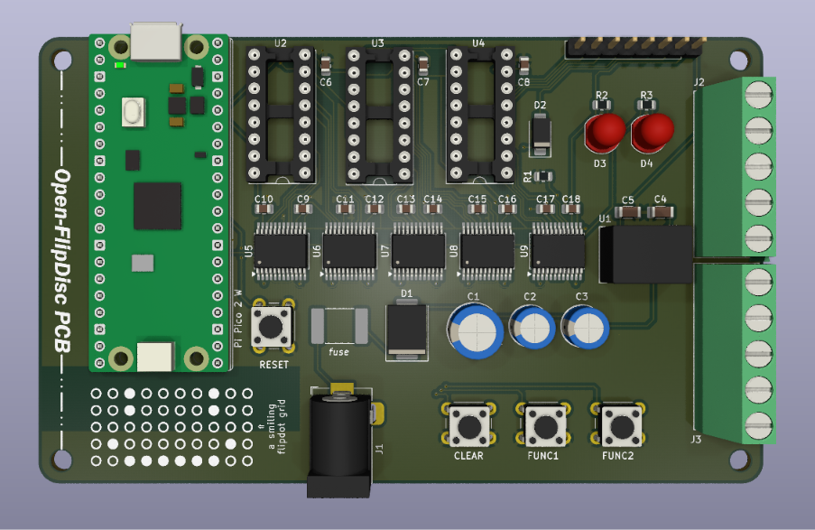
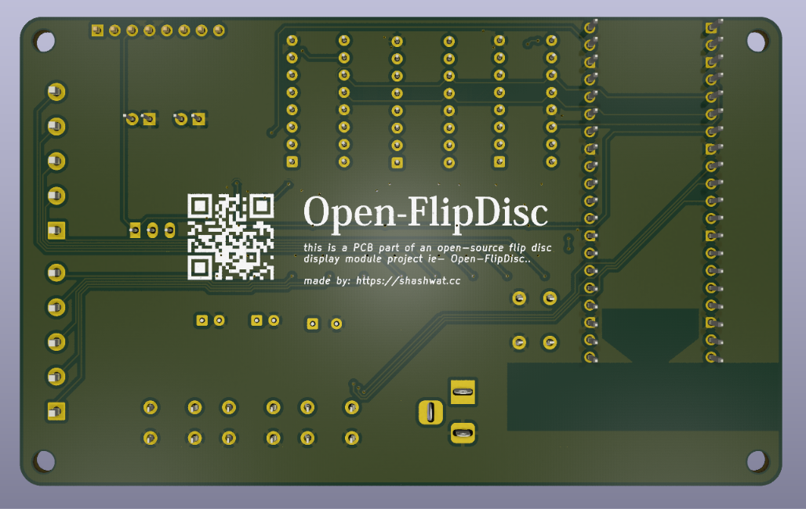
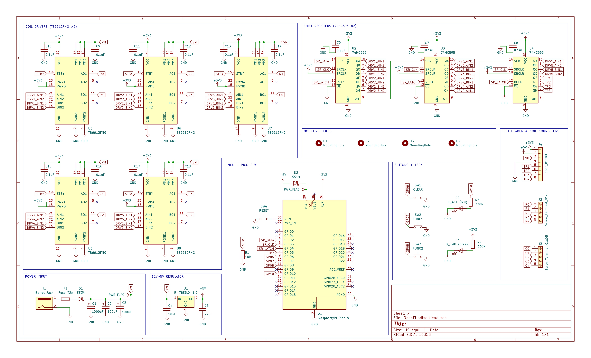
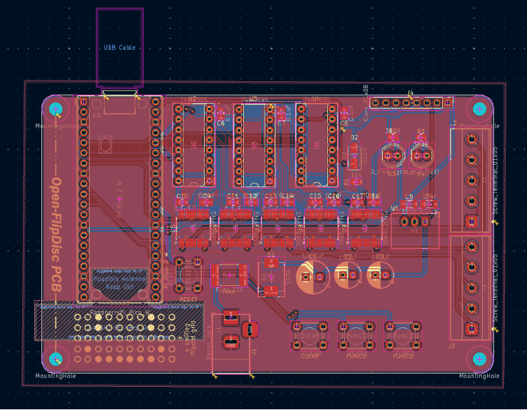
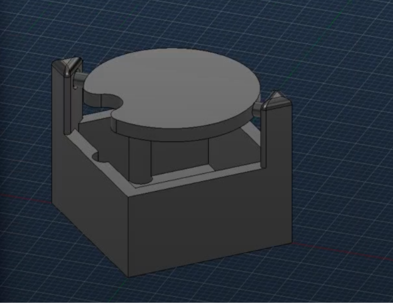
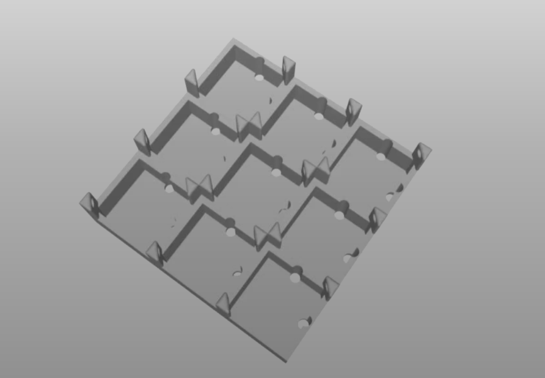
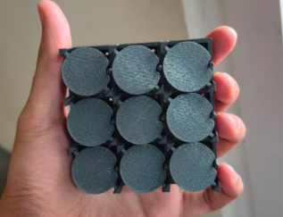

# Open-FlipDisc

an open source 5x5 flip-dot display module built around custom electromagnetic flip discs, a Raspberry Pi Pico 2 W, and a custom driver PCB.

I started this because small flip-dot modules are hard to find, and the polished commercial options from companies like [AlfaZeta](https://flipdots.com/en/home/) are too expensive for this project. this repository has all the work ive done on this project in my attempt to make my own flip dot display.. it also contains a PCB which can be used to drive the flipdots individually

### current design
- 5x5 flip-dot matrix, 25 individually controlled dots
- Raspberry Pi Pico 2 W controller
- TB6612FNG motor drivers for coil driving
- 74HC595 shift registers for expanding control lines
- 12V input with onboard 5V regulation
- JLCPCB SMD assembly for the SMD parts
- Through-hole parts, Pico, regulator, connectors, and mechanical hardware installed manually

here's how the PCB looks:

some CAD renders for module, made in fusion:

this is my first rough 3D printed draft 3x3 grid:

the bill of materials for this project can be found [here](BOM.csv)